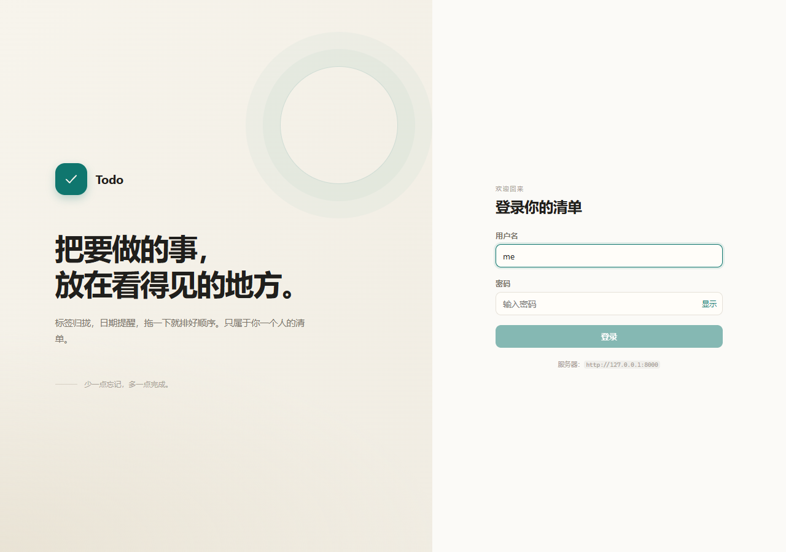
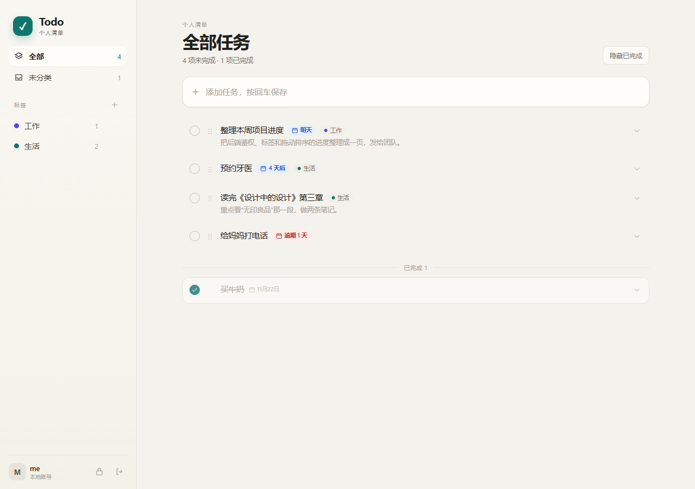
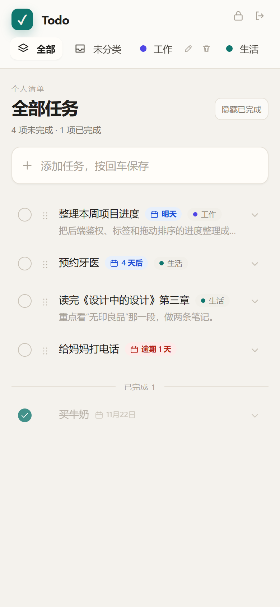

# Todo

个人待办清单。后端 FastAPI + PostgreSQL + SQLAlchemy + Alembic，客户端 Tauri 2 + React + TypeScript，Windows 桌面和 Android 共用同一套前端。

## 当前状态

- 后端：会话 Token 鉴权、标签、任务、拖动排序、已完成沉底、改密/撤销会话、pytest
- 桌面端：登录态本地持久化、标签筛选、任务增删改查、整行拖拽排序、拖到标签归类、单双击展开/编辑、退出登录确认、窗口大小和位置记忆、请求超时提示、改密
- Android：前端已按触屏适配（长按拖动、底部安全区、响应式布局），但本机尚未安装 Android 工具链，还没有实际打过 APK

## 界面预览







> 移动端截图是在 Chromium 里用 390×844 的移动视口模拟的，不是 APK 或真机截图；截图中的任务是早期演示数据。

## 目录

```
backend/
  app/
    api/            auth.py / tags.py / tasks.py
    main.py         FastAPI 入口
    models.py       SQLAlchemy 模型
    schemas.py      Pydantic 模型
    security.py     Argon2 / Token / 登录限流
  alembic/          数据库迁移
  tests/            pytest
  .env              本地数据库连接（已 gitignore）
frontend/
  src/              React 页面与组件
  src-tauri/        Tauri 配置、Rust 壳、图标
scripts/            启动和打包脚本
```

## 本地环境

- Python 3.13（虚拟环境在 `backend/.venv`）
- Node.js 24 + npm
- Rust 1.97 + MSVC（VS 2022 C++ 工具）
- PostgreSQL 18，服务端口 5432（`pg_hba.conf` 当前只允许本机连接）

数据库：

- 库：`todo`（开发）、`todo_test`（pytest）
- 连接用户：`postgres`（本机开发直接用超级用户；生产环境建议另建专用角色）
- 两个库和库内对象的所有者都已转给 `postgres`
- 连接串在 `backend/.env`，该文件不会提交

## 启动后端

```powershell
cd backend
.\.venv\Scripts\python.exe -m uvicorn app.main:app --host 0.0.0.0 --port 8000 --reload
```

也可以先激活虚拟环境：

```powershell
cd backend
.\.venv\Scripts\Activate.ps1
uvicorn app.main:app --host 0.0.0.0 --port 8000 --reload
```

Windows 的虚拟环境激活脚本是 `Scripts\Activate.ps1`，不是 Unix 的 `bin/activate`。如果 PowerShell 拦截脚本执行，用 `Set-ExecutionPolicy -Scope Process Bypass`，或者直接使用上面的 `.\.venv\Scripts\python.exe`，不激活也能跑。

或者从项目根目录：

```powershell
.\scripts\dev-backend.ps1
```

- 接口文档：http://127.0.0.1:8000/docs
- 健康检查：http://127.0.0.1:8000/api/health

监听 `0.0.0.0` 是为了让手机通过局域网访问。Windows 防火墙需要放行 TCP 8000（专用网络）：

```powershell
New-NetFirewallRule -DisplayName "Todo API 8000" -Direction Inbound -Protocol TCP -LocalPort 8000 -Action Allow -Profile Private
```

手机访问地址：`http://192.168.1.12:8000`（这台机器当前 WLAN IP）。

## 启动桌面端

```powershell
cd frontend
npm install
npx tauri dev
```

只预览网页（不启动 Tauri 壳）：

```powershell
npm run dev
```

窗口大小和位置由 `tauri-plugin-window-state` 自动保存，下次启动恢复；首次启动使用默认的 1120×780。

## 本地账号

仅用于本机开发：

```
用户名：me
密码：todo123456
```

登录后可以在左下角锁图标里改密码。改密会让所有会话失效，需要重新登录。云上部署时请生成自己的 Argon2 哈希并用 SQL 插入，不要复用这个账号。

## 测试

```powershell
cd backend
.\.venv\Scripts\python.exe -m pytest -q
```

测试使用 `todo_test` 库，会重建表，不会动 `todo` 里的数据。

## 构建 Windows 安装包

```powershell
.\scripts\build-windows.ps1
# 或指定后端地址
.\scripts\build-windows.ps1 -ApiBaseUrl "https://todo.example.com"
```

产物：`frontend/src-tauri/target/release/bundle/nsis/Todo_0.1.0_x64-setup.exe`。当前版本已构建过一次，约 2 MB。

## 构建 Android APK（工具链装好后）

前置：Android Studio、JDK 17+、SDK Platform、Build Tools、NDK，以及 Rust 的 Android target：

```powershell
rustup target add aarch64-linux-android armv7-linux-androideabi i686-linux-android x86_64-linux-android
```

首次初始化 Android 工程：

```powershell
cd frontend
npx tauri android init
```

本地 HTTP 联调还要在 `src-tauri/gen/android/app/src/main/AndroidManifest.xml` 的 `<application>` 上允许明文流量：

```xml
<application android:usesCleartextTraffic="true" ...>
```

同时建议加上 `android:allowBackup="false"`，避免登录 Token 进入系统云备份。

然后：

```powershell
.\scripts\build-android.ps1
# 或
$env:VITE_API_BASE_URL = "http://192.168.1.12:8000"
npx tauri android build --apk
```

APK 在 `src-tauri/gen/android/app/build/outputs/apk/`。正式走 HTTPS 后应把 `usesCleartextTraffic` 关掉。

## 后端地址是构建期常量

`frontend/src/api.ts` 的优先级：

1. 构建时环境变量 `VITE_API_BASE_URL`
2. 未设置时：Android 用 `http://192.168.1.12:8000`，Windows 用 `http://127.0.0.1:8000`

地址变了需要重新打包，这是当前约定。登录页会显示当前编译进去的地址，方便排查。

## API 一览

| 方法 | 路径 | 说明 |
|---|---|---|
| POST | `/api/auth/login` | 登录，返回会话 Token |
| POST | `/api/auth/logout` | 撤销当前会话 |
| GET | `/api/auth/me` | 当前用户 |
| POST | `/api/auth/password` | 改密，撤销全部会话 |
| GET | `/api/auth/sessions` | 有效会话列表 |
| DELETE | `/api/auth/sessions/{id}` | 撤销指定会话 |
| GET/POST | `/api/tags` | 标签列表 / 新建 |
| PATCH/DELETE | `/api/tags/{id}` | 改名改色 / 删除（任务转未分类） |
| PUT | `/api/tags/order` | 标签排序 |
| GET | `/api/tasks` | 全部任务，未完成在前、已完成按完成时间倒序 |
| POST | `/api/tasks` | 新建任务 |
| GET/PATCH/DELETE | `/api/tasks/{id}` | 单任务 |
| POST | `/api/tasks/{id}/move` | 拖动排序 / 移动到标签 |

## 设计边界

- 单用户，不开放注册；无搜索、日历、提醒、优先级、子任务、附件
- 一个任务最多一个标签；删除标签不删任务
- 排序全局一份，只对未完成生效；新建追加到末尾；无自动排序
- 请求超过 15 秒会中断并提示“请求超时，请检查网络连接”；断网提示“获取数据失败，请检查网络连接”；两者都不清登录态、不做离线缓存
- 已完成任务沉底、不可拖动，取消完成回到原位
- 不引入 Docker；部署时由使用方自行写 compose 和数据库环境变量
